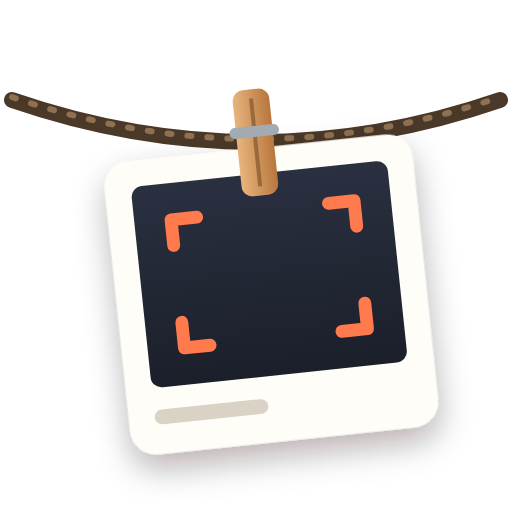
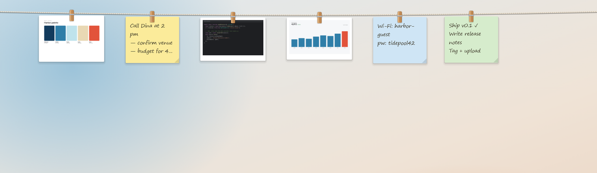
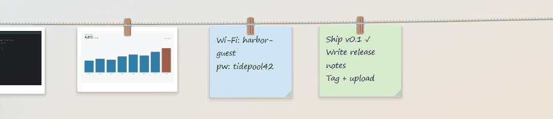
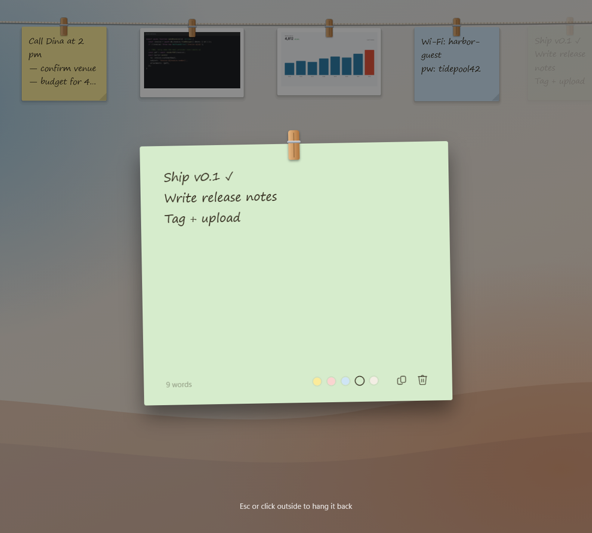
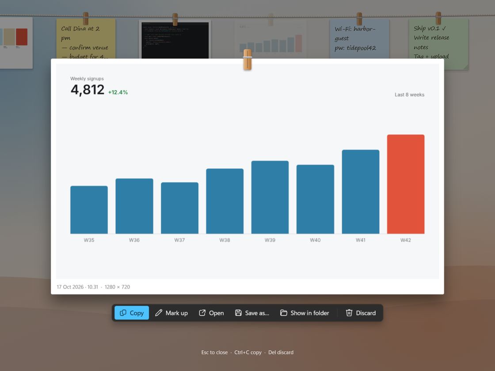
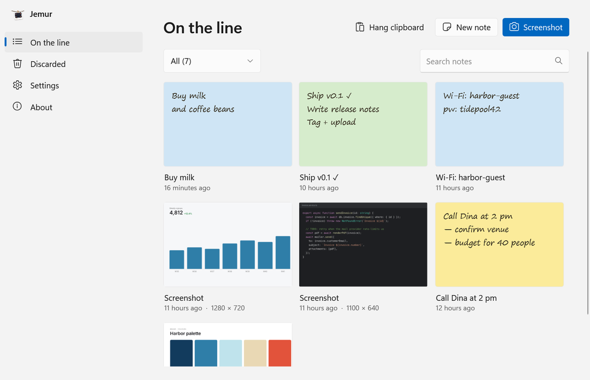
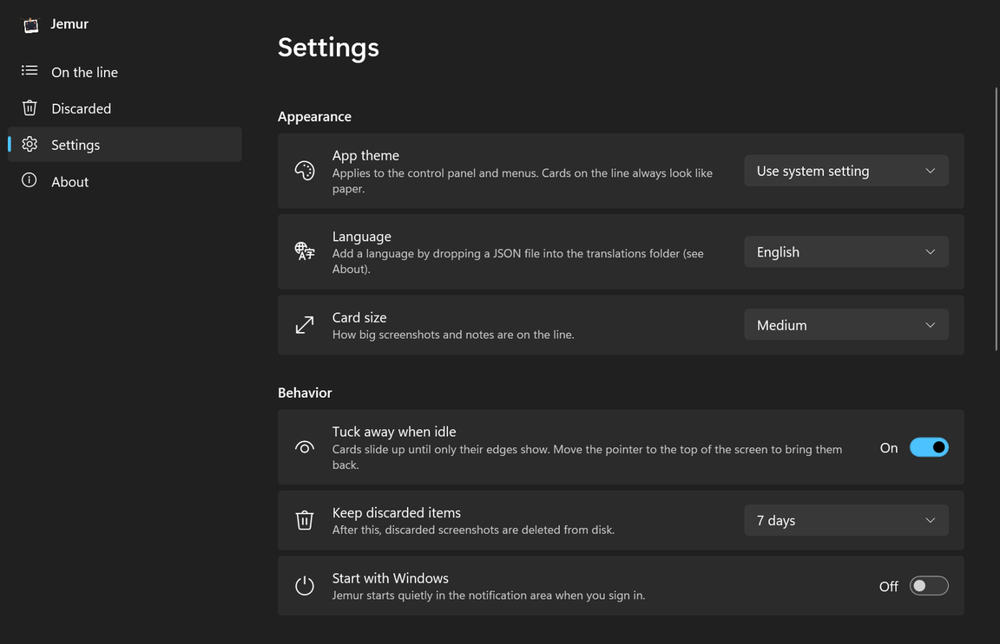
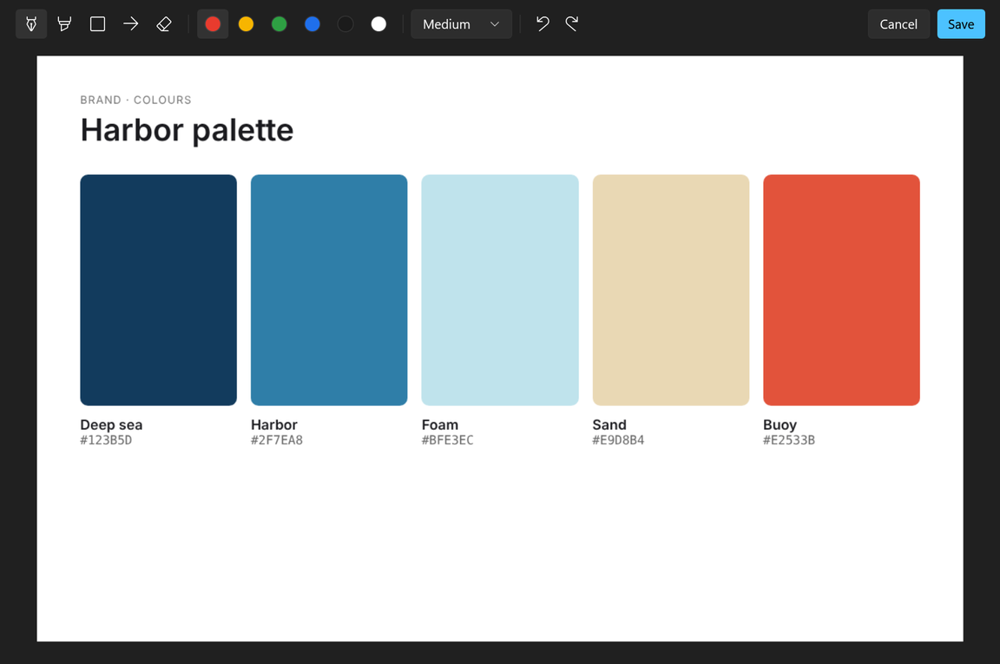
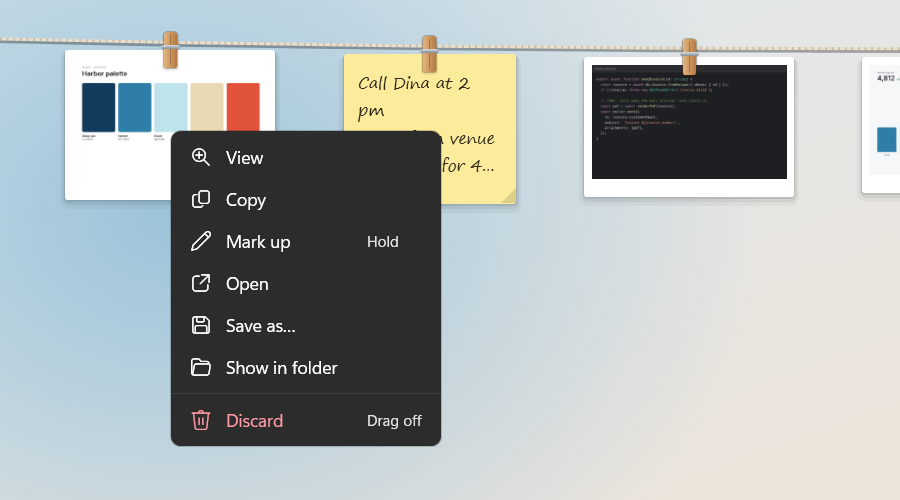

<p align="center">
  
</p>

<h1 align="center">Jemur</h1>

<p align="center">
  Hang screenshots and notes on a clothesline across the top of your screen.<br>
  A small, native Windows utility. Free and open source.
</p>

<p align="center">
  <a href="https://github.com/revanapriyandi/jemur/releases/latest"><b>Download</b></a> ·
  <a href="#features">Features</a> ·
  <a href="#screenshots">Screenshots</a> ·
  <a href="#shortcuts">Shortcuts</a> ·
  <a href="#why-i-built-this">Why</a>
</p>

<p align="center">
  <a href="https://github.com/revanapriyandi/jemur/actions/workflows/ci.yml"></a>
  <a href="https://github.com/revanapriyandi/jemur/releases/latest"></a>
  
  <a href="LICENSE"></a>
</p>

<p align="center">
  
</p>

*Jemur* is Indonesian for hanging things out to dry. The reference you need for the next few minutes — part of a design, an error message, a phone number — hangs where you can see it, instead of getting buried in a folder or under a pile of windows.

## Why I built this

During a normal workday I keep a lot of small things around: a screenshot of a bug, a colour from a design, a client's address, a checklist for a deploy. I used to keep them in a notes app or leave them as files and open windows on my desktop. Before long there were too many, they were scattered everywhere, and I kept losing track of what was where.

Then a simple idea came to me: what if they just hung along the top of the screen, like clothes on a line? Always there when I glance up, out of the way when I don't need them, and easy to take down when I'm done. That idea became Jemur. It has made my own work noticeably tidier, so I'm sharing it in case it helps you too.

## Features

<p align="center">
  
</p>

- **Screenshot straight to the line.** <kbd>Alt</kbd> <kbd>Shift</kbd> <kbd>S</kbd>, then drag an area, click a window, or press <kbd>Enter</kbd> for the whole screen. The capture drops onto the line with a little swing.
- **Notes on paper.** <kbd>Alt</kbd> <kbd>Shift</kbd> <kbd>N</kbd> brings a sheet to the middle of the screen. Type, pick a colour, click outside — it hangs itself back up.
- **Bring anything closer.** Click a card and it comes to the middle of the screen, where you can copy, mark up, open or save it.
- **Share by dragging.** Pull a card down off the line and drop it into WhatsApp, Slack, an email or a folder — anything that accepts files.
- **Let it go.** Drop a card on empty space and it falls away. It waits in *Discarded* for a week (configurable) in case you change your mind.
- **Mark up.** Press and hold a screenshot to draw on it with a pen, highlighter, box or arrow.
- **Out of sight.** When you're not using it, the line tucks itself away and only the bottom edges of the cards peek out. Touch the top of the screen to bring it back.
- **Feels like Windows.** Light and dark mode, your accent colour, Mica, keyboard shortcuts you can change, and a tray icon that matches your taskbar.

## Screenshots

<table>
  <tr>
    <td width="50%"></td>
    <td width="50%"></td>
  </tr>
  <tr>
    <td align="center"><sub>A note, taken off the line to write on</sub></td>
    <td align="center"><sub>A screenshot up close, with quick actions</sub></td>
  </tr>
  <tr>
    <td></td>
    <td></td>
  </tr>
  <tr>
    <td align="center"><sub>Everything on the line, in one place</sub></td>
    <td align="center"><sub>Settings, following the Windows 11 style</sub></td>
  </tr>
  <tr>
    <td></td>
    <td></td>
  </tr>
  <tr>
    <td align="center"><sub>Mark up a screenshot before sharing it</sub></td>
    <td align="center"><sub>Every action is a right-click away</sub></td>
  </tr>
</table>

## Install

1. Download `Jemur-<version>-win-x64.zip` from [Releases](https://github.com/revanapriyandi/jemur/releases/latest) (`win-arm64` for ARM devices).
2. Unzip it anywhere and run `Jemur.exe`. It lives in the notification area.
3. Optional: turn on **Settings → Start with Windows**.

The regular zip needs the [.NET 10 Desktop Runtime](https://dotnet.microsoft.com/download/dotnet/10.0) — Windows offers to install it the first time. The `-standalone` zip has everything built in.

Runs on Windows 10 (1809 or later) and Windows 11. Mica and rounded corners appear on Windows 11.

## Shortcuts

| Action | Default |
|---|---|
| Take a screenshot | <kbd>Alt</kbd> <kbd>Shift</kbd> <kbd>S</kbd> |
| New note | <kbd>Alt</kbd> <kbd>Shift</kbd> <kbd>N</kbd> |
| Hang whatever is on the clipboard (image, image file or text) | <kbd>Alt</kbd> <kbd>Shift</kbd> <kbd>V</kbd> |
| Show or hide the line | <kbd>Alt</kbd> <kbd>Shift</kbd> <kbd>J</kbd> |
| Open Jemur | <kbd>Alt</kbd> <kbd>Shift</kbd> <kbd>P</kbd> |

Change any of them under **Settings → Keyboard shortcuts**. In the mark-up editor: <kbd>P</kbd> pen, <kbd>H</kbd> highlighter, <kbd>R</kbd> box, <kbd>A</kbd> arrow, <kbd>E</kbd> eraser, <kbd>Ctrl</kbd>+<kbd>Z</kbd> / <kbd>Ctrl</kbd>+<kbd>Y</kbd> undo and redo.

## Light on resources

Jemur sits in the background all day, so it's built to stay small:

- no WinForms or System.Drawing — the tray icon, shortcuts and screen capture talk to Win32 directly;
- thumbnails are decoded at the size they're shown and shared between views, never at full resolution;
- nothing animates or polls while the line is idle, and the line window shrinks to a thin strip when tucked away;
- memory is handed back to Windows after the heavy moments — a capture, closing the control panel.

Tucked away, Jemur shows about **3 MB** in Task Manager's *Memory* column, with or without items on the line. While the line or the control panel is on screen it uses more (roughly 30–80 MB, mostly WPF's renderer) and gives it back once it's tucked away again. Measurements and how to reproduce them: [docs/MEMORY.md](docs/MEMORY.md).

## Privacy

Everything stays on your PC. Screenshots and notes live in `%APPDATA%\Jemur`. There is no network code, no telemetry and no account.

## Languages

English and Bahasa Indonesia are included. Adding a language is a single JSON file and no code — see [docs/TRANSLATING.md](docs/TRANSLATING.md).

## Build from source

```powershell
git clone https://github.com/revanapriyandi/jemur
cd jemur
dotnet run --project src
```

Requires the [.NET 10 SDK](https://dotnet.microsoft.com/download/dotnet/10.0). [CONTRIBUTING.md](CONTRIBUTING.md) covers the project layout, tests and guidelines.

## Credits

Inspired by Tendedero, a macOS app by [@alejandr0bujan](https://x.com/alejandr0bujan). Jemur is an independent Windows implementation and shares no code with it.

## License

[MIT](LICENSE) © 2026 M. Revan Apriyandi
